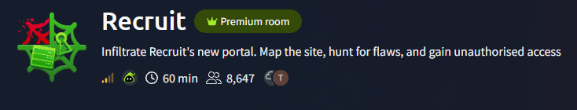

# Recruit - TryHackMe Writeup
A medium difficulty challenge from the module "Web Application Vulnerabilities I". In the respective module we studied five of the most impactful vulnerabilities in modern web applications: SQL Injection, CSRF, XSS, SSRF and IDOR. So most certainly this challenge is about testing these five vulnerabilities.

